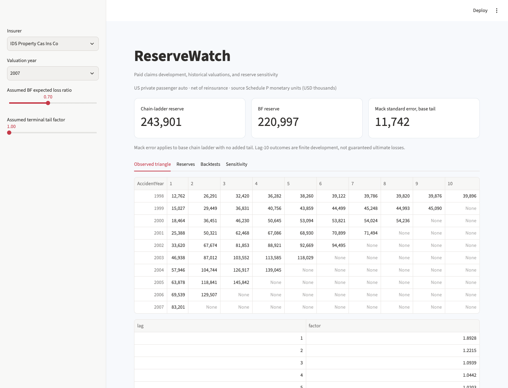

# ReserveWatch

A paid-claims development workbench that reconstructs historical valuation triangles, compares reserve methods, and evaluates estimates against subsequently observed payments.



## What it does

- Public CAS Schedule P private-passenger-auto data with fixed illustrative insurer panel.
- Valuation-safe observed triangle construction and interior-cell validation.
- Volume-weighted chain ladder and Bornhuetter–Ferguson with explicit prior loss-ratio assumptions.
- Backtests at 2007, 2008 and 2009 valuations against later observed development through lag ten.
- Independent chainladder-python verification, Mack standard errors, tail/prior sensitivity and reserve movement.
- Interactive triangle review, formula-driven Excel example, PDF analysis and standalone charts.

## Run locally

Python 3.12 is the tested runtime.

```bash
python3 -m venv .venv
source .venv/bin/activate
python -m pip install -e '.[dev]' -c constraints.txt
reservewatch run
streamlit run app.py --server.port 8514
```

Run these commands from this repository. For a non-editable installation or a different working
directory, set `PROJECT_ROOT` to the repository path. Raw downloads, local models and processed
datasets are ignored by Git; the run command regenerates them. Reports are included for review.
Network access is required for first-time public-data/model downloads where applicable.

`constraints.txt` records the dependency versions used in local validation. It is a tested version
constraint set, not a cross-platform hash lock. Ordinary dependency resolution still handles
platform-specific packages. Runtime dependencies are declared in `pyproject.toml`.

## Inspect the evidence

- analysis.pdf — reserve findings and limitations
- package_verification.csv — fifteen independent reserve comparisons
- accident_year_estimates.csv — method estimates by valuation and accident year
- backtests.csv — predictions against later observed payments
- valuation_summary.csv and reserve_movement.csv — review summaries
- sensitivity.csv — assumed loss-ratio and tail factors
- reserve_review.xlsx — editable insurer-43 calculation

Outputs live in `reports/`. [Read the generated analysis](reports/analysis.md),
[methodology](docs/methodology.md), [data dictionary](data/README.md),
and [validation record](docs/validation.json).

## Data and scope

Private passenger auto liability/medical data accessed from the CAS research resource, compiled for the CAS by S&P Global Market Intelligence. Net of reinsurance; source Schedule P monetary units are USD thousands. Accident years 1998–2007 and lags one through ten. Fixed codes 43, 388, 1090, 2003 and 4839 form an illustrative panel, not a representative market sample.

Per-source download records store hashes and timestamps. A pre-existing local download is
identified as such if its original retrieval time was not captured. `data/provenance.json`
records the dataset and treatment assumptions. Refresh public sources explicitly when needed;
refreshing can change results.

## Walkthrough

1. Inspect the 2007 observed triangle and the unobserved lower cells.
2. Compare chain-ladder and BF reserves by accident year.
3. Change the assumed BF expected loss ratio and terminal tail factor.
4. Inspect the fifteen package-verification rows and zero reserve differences.
5. Compare estimates with later payments through lag ten; distinguish finite development outcomes from ultimate losses.

## Validate

```bash
python -m pytest -q
python -m ruff check src tests
python scripts/verify_artifacts.py
```

Unit tests use small, interpretable fixtures. Artifact verification checks reconciliations,
report/workbook structure and generated-file hashes. Generate the data before running the
artifact verifier. The validation record distinguishes executed checks from deployment configuration.

## Container

After generating the project data, build from this repository:

```bash
docker build -t reservewatch:local .
docker run --rm -p 127.0.0.1:8514:8501 reservewatch:local
```

The build copies generated local inputs so the application can open them. Rebuild after
regeneration. Docker configuration does not itself establish a hosted deployment. Development
servers bind to local ports in these examples.

## Layout

```text
src/reservewatch/     analytical code, CLI and application
tests/                correctness and boundary fixtures
data/                 provenance, dictionary and regenerable inputs
reports/              measured results and shareable artifacts
docs/                 methodology, preview and validation evidence
scripts/              standalone artifact verification
```
